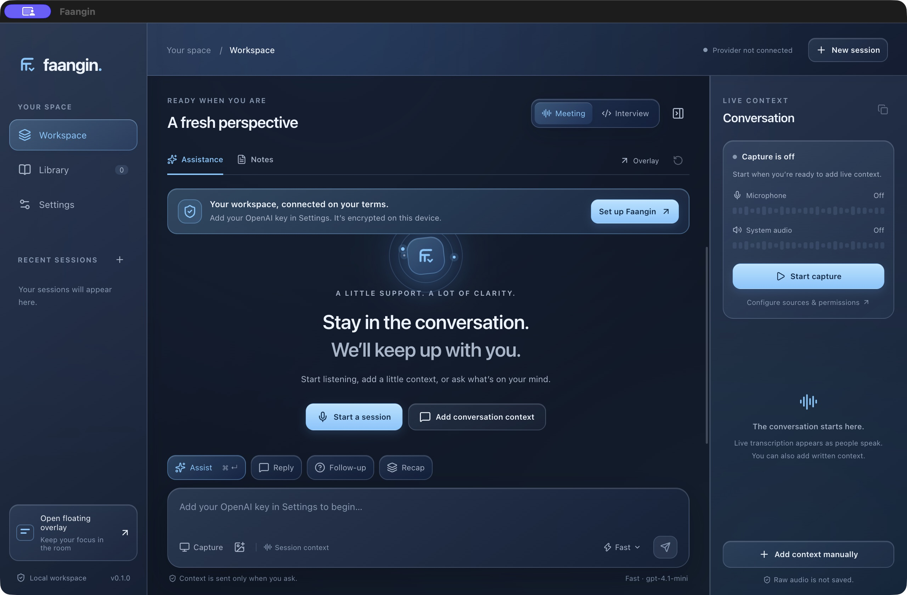

# Faangin

A desktop workspace for meeting context and technical interview practice, with a floating assistant, streamed answers, screen context, and local session history.

Faangin's first build targets Apple Silicon Macs. Windows packaging is configured; Windows operation has not been validated.



The current version is **0.4.3**, improving conversational interview delivery, grounded follow-ups and completed-utterance handling. New installations use GPT-6 Luna for Fast mode and GPT-6.1 Sol for Smart mode; existing saved model choices remain intact. Sol in Smart mode is the selected configuration for the final engineering evaluation. See the [0.4.3 verification record](docs/engineering/conversational-043.md) for tested behavior, model selection and remaining acceptance limits.

Version **0.3.3** fixed overlay controls: it opens interactive, only the logo/status area drags, and click-through is an explicit opt-in. **Control–Option–S** captures and solves in one step. The header keeps the primary controls and puts secondary tools under More. Those historical artifacts are in `dist/interaction-repair-candidate`; the normal launch copy is `dist/mac-arm64/Faangin.app`. See [interaction repair and verification](docs/engineering/overlay-interaction-v033.md).

The existing hands-free interview, neutral themes, current-solution follow-ups, and screenshot-selection controls are preserved. See [hands-free behavior](docs/engineering/hands-free-interview.md) and [audio permissions](docs/engineering/audio-permissions.md).

## What you can do

- Use Meeting or Interview workspaces with quick actions for assistance, replies, follow-up questions, source-linked follow-up drafts, recaps, hints, coding solutions, attempt review, debugging, system design, and behavioral practice.
- Save an interview brief with the target company and role, round, stage, problem, constraints, and your current code or explanation. The target company provides preparation context, not a private hiring rubric or an outcome guarantee.
- Add typed context, capture a selected screen or a chosen region, or import problem images. Review Markdown answers and code as they stream; cancel a request when needed.
- Transcribe microphone and system audio through separate source channels, with visible capture health and audio levels.
- Enable optional **Live suggestions** to request spoken replies automatically after finalized speech from a selected audio source; manual Reply remains available.
- Prepare a factual profile, job description, response preferences, language, and note template. Import selectable text from TXT, PDF, or DOCX files.
- Edit notes, search sessions, move sessions to Trash, restore them, and export Markdown or JSON.
- Prepare follow-up messages from finalized conversation text. Open each source link to inspect the included passage; source snapshots remain available in saved drafts and copied/exported Markdown. Review and copy the draft yourself; the app does not send it.
- Open a movable floating overlay and use global shortcuts. Adjust its appearance and interaction mode.
- Set overlay background opacity anywhere from 0–100%; text stays fully opaque. macOS accessibility preferences can replace transparency with solid surfaces.

Chat can use your OpenAI account or an explicitly configured compatible chat service, including a local server. OpenAI remains the speech provider. Separate provider keys are entered in Settings, encrypted with OS-backed credential storage, and never returned to the interface. A compatible key is bound to the exact saved endpoint; the OpenAI key is never reused there. Context goes to the selected chat destination on manual requests, or automatically while listening with **Live suggestions** enabled. Automatic suggestions exclude images and provisional text, but can include bounded finalized conversation, saved background/brief/notes, opted-in history and selected prior-session excerpts. Selected images are included only in manual actions that admit them. Enabled audio goes to OpenAI while capture runs. OpenAI Responses requests set `store: false`.

Faangin is built for interview practice and meetings. Computer audio includes other people's voices, so tell the people on a call that you are transcribing, get their consent where the law requires it, and follow the rules of the interview, employer, school, or platform you are using. Faangin shows this notice once and asks you to acknowledge it before it first listens to computer audio.

Saved transcripts, answers, and notes remain in a local SQLite workspace. Turn off **Save session history** to keep new sessions and further edits to the active session in RAM until exit. Existing saved snapshots remain unchanged; turning history back on does not save a RAM session automatically. Preferences and presets stay saved. Raw audio is not saved. Screen attachments are held in memory and disappear when the app closes. Session exports can contain private text, so review them before sharing.

## Run locally

Unreleased changes after 0.4.2 position Faangin as an interview-practice and meeting assistant. The setting that asks the OS to exclude Faangin windows from screen capture is off by default and no longer offered during setup. The Cluely and InterviewCoder shortcut presets are removed; a saved choice of either falls back to the Faangin keymap. Listening to computer audio waits for the one-time notice above.

Version 0.4.2 makes access setup the first screen. Screen capture, microphone, and computer audio must be ready before opening the workspace or overlay. The app guides OS approvals, rechecks automatically, configures the inputs, and keeps listening off until started. See [permission-first setup](docs/design/access-setup-042.md).

Version 0.4.1 repairs oversized saved overlay windows and adds a visible native resize grip, size presets, and reset controls in More, Settings, and the menu bar. The native menu displays the running version; quit any older candidate before launching the newly installed app. See [overlay recovery and verification](docs/design/overlay-041.md).

Version 0.4.0 adds a four-step first-run guide for choosing a workspace, understanding optional permissions, and learning the compact overlay. You can explore immediately and reopen the guide from **Settings → Replay setup guide**. New profiles follow your system appearance and use a readable 94% overlay background with a smaller 560 px starting height. Existing preferences are preserved. See the [setup and overlay design notes](docs/design/onboarding-040.md).

Use Node.js 22.13 or newer and a macOS 14.4 or newer Apple Silicon machine for the initial native build.

```sh
npm ci
node node_modules/electron/install.js
npm run dev
```

In **Settings → Connection & models → OpenAI connection**, enter a replacement API key, select **Save key**, and use **Check OpenAI model access**. Choose microphone and/or system audio, then start a session. macOS may request microphone, screen recording, or audio capture permission. Grant the permission in System Settings and restart capture if needed. Typed context and imported images work independently of live audio.

**Check OpenAI model access** checks configured Fast, Smart, and transcription model visibility using read-only requests; model visibility does not establish generation quota. **Test chat generation** explicitly sends a tiny, potentially billable request to each distinct configured Fast/Smart chat model; it sends no session context. A successful tiny request does not certify real answer or audio quality. Start with a typed question, then test each enabled audio source.

For interview practice, create an Interview session and open **Interview brief**. Save the question, constraints, and your attempt, then return to **Assistance**. Choose **Hint** for an incremental next step, **Solve** for a complete proposed solution, or **Review** for evidence-based feedback on your attempt. Typed composer text is included when using quick actions. Code is analyzed and never executed by the app.

For a spoken question in a remote call, choose **Question audio → Remote call · computer audio → Listen**, verify the interviewer’s words in **Conversation**, then choose **Answer follow-up**. For speech in the room, choose **In person · microphone**. Source presets enable only the question source; explicitly add the second source when needed. For automatic replies in 0.2.4, enable **Automatic replies** directly in the interview. The selected question audio determines the trigger source. It is off by default and automatic requests incur provider usage. For speech in the room, select Microphone; a source identifies an input, not a person, so your own speech can also trigger suggestions. **Capture screen** only takes a screenshot. Manual Reply remains available in both modes, the expanded overlay and Conversation. See [spoken-question setup and controls](docs/engineering/spoken-questions.md).

Live suggestions react to finalized selected-source utterances, including statements and follow-ups; there is no question classifier. A nominal 350 ms settling delay, at least three seconds between starts, six automatic starts per rolling minute and one active/latest pending request bound dispatch. Continuing partial speech defers the next request. Stop listening, disable the mode or take manual action to cancel automatic work. Provider failure pauses suggestions without automatic retry; resolve the error and explicitly toggle/reconfigure/restart to resume. Cards show **Automatic suggestion**, and Conversation displays the current status/reason. Composer text and editor drafts are preserved.

In **Context & presets**, choose a response preset and note template, or create your own in Settings. Search prior saved sessions and explicitly select up to four attributable excerpts. You can edit or remove them; search alone never includes them in a request. Selected excerpts stay in RAM and are rechecked against their saved source before dispatch.

To capture part of a screen, choose the **Capture a region** crop button beside **Capture screen**. Drag on the local preview or enter its bounds in preview-image pixels, then choose **Add region**. The full-source preview is held temporarily in RAM; only the confirmed rectangle becomes an attachment. Previewing alone does not select or send the full frame, and Cancel adds nothing. The preview expires after two minutes. Review the attachment selection before requesting assistance.

For a follow-up message, add finalized conversation text and choose **Draft** in a Meeting workspace, or **Notes → Draft follow-up**. Optional composer wording controls the requested style. The draft uses only the bounded finalized transcript: selected images, profile, existing notes, prior answers and prior-session excerpts are excluded. Open a **T1**, **T2**, or other source button to see its channel, time and exact included text. These labels identify passages, not speakers. Check claims, owners and dates before copying. Drafts keep your notes separate; retrying preserves the original action and wording. Copied/exported Markdown includes source excerpts and working CommonMark source links.

Capture supports Pause/Resume, a configurable inactivity timeout, and explicit microphone selection through **Refresh devices**. The system-audio source is the default output, independent of the screenshot source. Reorder screenshot attachments with their arrow buttons; selection remains explicit. Collapse the overlay from its header and expand it to restore its prior height. Library search includes answers and interview briefs, and date filters apply before the result limit. Trash supports recovery and a separate permanent-delete confirmation.

During active capture, assistance may include current provisional speech. Those answers carry a visible note; unfinished speech can change. Recaps, meeting notes and follow-up drafts use finalized transcript only. Fast interview assistance uses a smaller recent transcript budget while keeping the saved brief. In the 0.2.1 latency candidate, **Fast** asks for a useful short opening before the required code and detail. Choose it with the existing Fast/Smart toggle; your configured model IDs remain unchanged.

Nanosecond-scale cloud answers are unattainable. The latency update removes repeated prompt/state work, delivers the first text update immediately, and batches later updates by frame. **First text** measures main-process request preparation and transport until the first received non-whitespace text; **Finished in** measures generation duration. Neither is a physical screen-paint measurement. The 0.3.0 [synthetic live trial](docs/engineering/hands-free-interview.md#verification) reports observed transcription and first-answer timings; it is not a representative hardware or network benchmark. See [latency and manual measurement](docs/engineering/latency.md) for the exact scope and a three-trial-per-mode comparison with your configured provider.

```sh
npm run typecheck
npm test
npm run build
npm run smoke
npm run package:mac
```

`npm run verify` runs tests, a production build, and hidden desktop workflow checks using a disposable workspace. These verify actual preload/IPC operation and restart without your credentials, recordings, or primary app data. They are not live model-quality or hardware-audio tests.

Historical 0.2.3 introduced opt-in Live suggestions. Its final 385-test suite and typecheck/production build passed. An earlier seven-request localhost source smoke passed; the expanded final nine-request smoke was not executed because Codex automatic approval review hit its usage limit. No 0.2.3 app bundle or installer has been produced. `dist/live-candidate` is the planned output, not an available artifact. At that checkpoint, the latest verified installer remained 0.2.2 in `dist/spoken-candidate` and has manual Reply. No primary user preference was changed. Fixture transcripts use the same final-ingestion callback, not real recorded speech. See the [historical 0.2.3 checkpoint](docs/engineering/build-status.md#live-suggestions-candidate-023).

Historical 0.2.2 remains at `dist/spoken-candidate` with 343 passing tests/build/package/six-request fixture smoke; 0.2.1 remains at `dist/latency-candidate` with 334 passing tests, and 0.2.0 at `dist/candidate`. Each keeps its own hashes and provenance. Before switching bundles, save/export needed data, including RAM-only sessions, and quit the previous instance. Opening another bundle while Faangin runs focuses the existing workspace. See the [build verification record](docs/engineering/build-status.md) for each version’s exact artifacts. Fixtures do not certify live audio, model quality, cloud latency or physical paint.

The standard local packaging command produces `dist/mac-arm64/Faangin.app`. `npm run dist:mac` also builds a DMG and ZIP. These are local unsigned development artifacts. A separate `npm run release:mac` command requires real Apple signing and notarization credentials, verifies the signed app and DMG, and produces final checksums. See [release setup](docs/engineering/release-readiness.md#signed-macos-release) before running it. `npm run dist:win` prepares the Windows installer configuration for validation on Windows.

## Controls

| Shortcut | Action |
| --- | --- |
| Control + Option + S (macOS) / Ctrl + Alt + S | Capture the selected screen and solve the new image |
| Control + Option + I (macOS) / Ctrl + Alt + I | Toggle explicit click-through mode |
| Control + Option + W (macOS) / Ctrl + Alt + W | Open the full workspace |
| ⌘ / Ctrl + Enter | Request assistance |
| ⌘ / Ctrl + Shift + Enter | Solve selected problem context |
| ⌘ / Ctrl + Shift + S | Capture screen context |
| ⌘ / Ctrl + Shift + Space | Show or hide the overlay |
| ⌘ / Ctrl + Shift + Escape | Stop capture and active answers |
| ⌘ / Ctrl + , | Open Settings in the focused workspace |

The overlay opens interactive. Move it only by dragging the logo/status area. Click-through is an explicit opt-in; opening the overlay again restores its controls. Background answer updates preserve your chosen interaction mode.

Shortcut registration status is visible in Settings. Availability depends on conflicts with other apps.

When the matching native shortcut is unavailable, an empty focused composer supports **⌘/Ctrl+Enter** for Assist from existing context; typed text requests Ask, and adding Shift requests Solve. An empty Send button remains disabled. Audio meters and the new conditional low-volume diagnostic do not prove recognized speech; check Conversation text before Reply.

## Engineering

Electron's main process owns credentials, SQLite, provider requests, native dialogs, and desktop controls. Sandboxed renderers have narrow preload capabilities: the workspace renders UI, the hidden capture surface produces PCM audio, and a separate temporary surface extracts document text. Capture generations and session context epochs reject stale asynchronous results.

The test suite covers storage recovery, request validation, capture lifecycle, region preview consent and stale leases, finalized draft provenance, CommonMark source links, streaming, and provider transport failure. Generated Retina fixtures verify a canonical image pixel grid; they do not certify physical screen capture. An independent hidden renderer fixture checked drafts, separate Notes controls and a T1 source modal. Earlier native accessibility inspection observed saved fixture drafts/source content, but screenshot and click behavior did not consistently match that state; the final computer-control attempt reported a locked Mac and failed automatic unlock. Final visible interaction and visual acceptance remain open. Live provider/audio tests, Apple signing, Windows and exact parity remain separate gates. See the [build verification record](docs/engineering/build-status.md) for the checked behavior and remaining native tests.

| Document | Purpose |
| --- | --- |
| [Project report](docs/project-report.md) | Research findings and product scope |
| [PRD](docs/prd.md) | Requirements and acceptance criteria |
| [Architecture](docs/engineering/architecture.md) | Process boundaries and technical design |
| [Desktop appearance](docs/engineering/design-system.md) | Apple HIG, blue accents, glass materials, and accessibility |
| [Feature status](docs/engineering/feature-status.md) | Requirement-by-requirement delivery and acceptance gaps |
| [Release readiness](docs/engineering/release-readiness.md) | Interview acceptance checks and remaining production gates |
| [Latency](docs/engineering/latency.md) | What the response timings measure and how to compare Fast/Smart |
| [Conversational responses](docs/engineering/response-delivery.md) | Delivery policy, completed-utterance handling, paired evaluation and remaining quality limits |
| [Spoken questions](docs/engineering/spoken-questions.md) | Select audio sources, verify conversation text and explicitly request Reply |
| [Delivery plan](docs/engineering/delivery-plan.md) | Work packages and ownership |
| [Validation plan](docs/engineering/validation-plan.md) | Functional and native release gates |
| [Product comparison](docs/research/product-parity.md) | Official evidence for the reference products |
| [Cue audit](docs/research/cue-audit.md) | Source and dependency findings |
| [REA live-suggestion investigation](docs/research/rea-live-suggestions.md) | Actual static analysis of public Cluely/InterviewCoder clients, trigger paths, provenance and limits |
| [Reliability audit](docs/research/reliability-audit.md) | Reference failure modes |
| [Rea live-suggestions investigation](docs/research/rea-live-suggestions.md) | Actual static client analysis, architectural findings and coverage limits |

## References and license

Feature research covers [Cue](https://github.com/Blueturboguy07/cue), [Cluely](https://cluely.com/), and [InterviewCoder](https://www.interviewcoder.co/). Cue was studied at commit `8dfe7165e845bf1d6e02b31a8bb67b80452cd56c`. Faangin uses original implementation and assets; no reference source or commercial binaries are incorporated. This repository's original work is MIT licensed. Dependencies retain their respective licenses.

The desktop candidate is a foundation for further parity work. The full PRD backlog remains in scope, including accounts, billing, calendar integrations, hosted sharing, mobile clients, and bundled local/offline models. Those features remain undelivered. Complete commercial-product equivalence has not been demonstrated.
