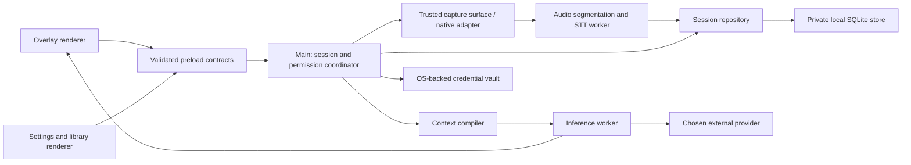
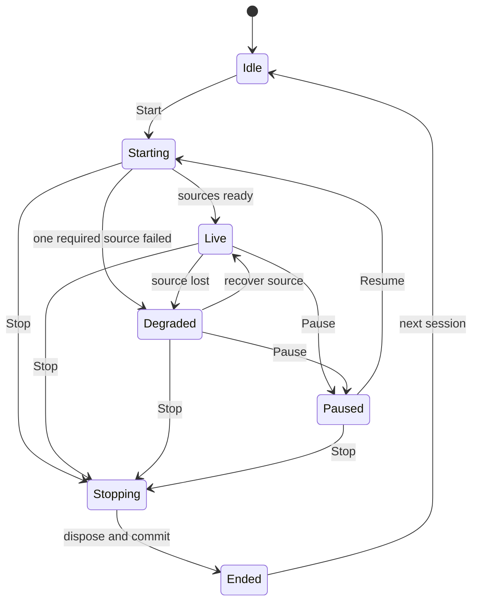

# Technical design

Status: proposed architecture for implementation review · October 11, 2026  
Scope: [PRD](../prd.md), macOS first  
Implementation status: no application code exists yet

## Architectural decision

Use a supported Electron release with TypeScript, a React renderer, a narrow validated preload bridge, and a local transactional session store. Keep capture, inference, and durable data independent of window presentation. Revalidate library versions and bundled Node capabilities when implementation starts; do not inherit Cue's old Electron or model defaults.

Electron is a pragmatic fit for the requested overlay and later Windows support. A browser-only application cannot establish global shortcuts or desktop capture-exclusion behavior. A native-only Swift application would improve access to platform APIs but duplicate more UI and domain code for Windows. Tauri reduces runtime footprint but introduces a Rust/native-plugin dependency for the highest-risk capture paths. The Electron choice is provisional on the macOS capture spike and measured resource budgets.

Current official documentation changes the audio assumptions in the reference code: newer Electron uses a CoreAudio Tap path on modern macOS, with required app metadata and possible silent stream failure. Prove this path in a packaged app before committing to a native helper. Add a narrowly scoped signed Swift helper only if measured capability gaps require one. [Electron desktopCapturer](https://www.electronjs.org/docs/latest/api/desktop-capturer).

## Process and trust boundaries

These are responsibility boundaries, not a mandate to create a process for every box. Native experiments determine which work can run in utility processes versus a dedicated trusted capture renderer. The provider worker receives only the credentials required for the admitted request. UI renderers never receive decrypted keys.

The overlay and library load only packaged application content. Use sandboxing, context isolation, no renderer Node integration, restrictive CSP, explicit navigation/new-window denial, and a limited external-link policy. Validate origin, frame, window identity, schema, size, and current operation on privileged messages. This follows Electron's documented renderer/IPC security model. [Electron security guidance](https://www.electronjs.org/docs/latest/tutorial/security).

Screen content, audio transcripts, imported documents, and model output are untrusted data. A screenshot instruction cannot grant filesystem or account access. Generated code is text only; there is no automatic shell execution or editor injection in the core assistant. Markdown renders through a constrained sanitizer and safe link handling.

## Module ownership

| Module | Responsibility | Forbidden coupling |
| --- | --- | --- |
| SessionCoordinator | Active session, capture generation, lifecycle transitions | UI booleans deciding device lifetime |
| WindowController | Overlay/library, geometry, privacy request, focus/click-through, shortcuts | Model requests embedded in window callbacks |
| PermissionService | Capability checks and permission recovery | Treating permission status as proof of actual audio frames |
| ScreenCaptureAdapter | Selected source/region, resolution, image limits, capture identity | Implicitly selecting an arbitrary first display |
| AudioCaptureAdapter | Source-specific audio frames and track lifecycle | Mixing microphone and system channels into unlabeled audio |
| TranscriptService | Partial/final segments, sequence IDs, reconnect/de-duplication | Resetting committed history when a partial revises |
| ContextCompiler | Bounded request snapshots and source attribution | Reading every file/session automatically |
| ProviderRegistry | Chat/speech capabilities, configured endpoints and models | Hardcoded unverified model IDs or automatic provider substitution |
| InferenceService | Admission, transport cancellation, streaming, usage, backoff | Different consent or timeout policy for background jobs |
| SessionRepository | Durable commits, search, migrations, retention, trash | Renderer writing files or reporting save success before commit |
| CredentialVault | OS encryption, set/replace/delete, provider metadata | Generic get-secret IPC |
| ImportExportService | Bounded parsing, previews, exports | Parsing large archives on the UI thread |
| DiagnosticsService | Redacted timings, resource measurements, export | Transcript/screenshot/credential logging |

Keep a small number of shared packages for domain types, contracts, and fixture tools. Avoid a service-per-feature deployment architecture. The D0 application does not need a hosted backend.

## Domain data model

| Entity | Essential fields and invariants |
| --- | --- |
| Session | ID, workspace type, title, start/end time, lifecycle status, capture generation, transcript epoch, selected profile/mode, retention policy |
| TranscriptSegment | Session ID, stable segment ID, source channel, sequence number, monotonic timing, wall-clock mapping, language, revision, partial/final flag; channel is not a verified person identity |
| ScreenAttachment | ID, session/problem ID, source display/window, captured time, dimensions/scale, MIME, byte count, digest, retention state |
| Problem | ID, attachment IDs in order, extracted statement, assumptions, language, output revisions; resetting advances its generation |
| AssistanceRequest | Request/session/problem IDs, action, immutable context snapshot ID, provider/model, status, timing, usage, error code |
| Answer | Request ID, streamed text/structured sections, completeness, source references, edit/copy state |
| Notes | Session ID, generation version, source transcript bounds, structured sections, user edits, status, timestamps |
| Profile | User-entered background/role/company/story fields, imported-document references, extraction preview, explicit active selection |
| PromptPreset | ID, name, workspace, output contract, user instructions, version; built-in defaults remain recoverable |
| Settings | Schema version, nonsecret preferences, source selections, shortcuts, retention and memory policy |
| CredentialReference | Provider ID and key-presence/status metadata only; ciphertext stored outside general settings |

Use stable identifiers everywhere. Do not derive transcript references from mutable array positions. Final transcript commits are idempotent by session/channel/segment ID. Request snapshots preserve the precise inputs used without automatically persisting screenshots.

## Lifecycle and cancellation

Every start/resume allocates a capture generation. Async permission acquisition, raw audio events, timers, and device reconnects carry it. Stop invalidates that generation synchronously, ends tracks, rejects late acquisitions, and blocks new speech dispatch. Separately, the transcript epoch identifies context ownership. Stop freezes a closing-session cutoff of already-admitted speech request IDs and audio sequence bounds; only their matching final results may commit for at most five seconds. Unsent queued audio is discarded with accounting and an incomplete-transcript indicator. After the deadline, abort remaining requests and close. Clear/reset advances the transcript epoch and rejects all old results, including those otherwise eligible for closing. Repeated Stop is idempotent.

Generation checks are necessary alongside transport abort. Abort may not prevent a provider from billing work already accepted; it prevents further client dispatch and stale output, not retroactive cost. Queued work must not be replayed automatically after a session ends.

Inference states are queued → admitted → streaming → complete, with cancelled/failed/partial terminal outcomes. Each request owns an AbortController and timeout policy. Cancellation reaches the actual HTTP/WebSocket/sidecar operation. Disposal has a two-second deadline; a non-responsive worker/sidecar is quarantined and terminated/replaced so it cannot wedge capacity. Any late events remain tagged and are dropped. Retrying is a new request with explicit context and usage semantics.

Notes are a separate job after durable session closure, requested explicitly or through a notes preference disclosed when Start is pressed. They use the same admission, credential, usage, timeout, and cancellation policies as interactive requests. Missing credentials or failed inference leaves the transcript available and notes visibly pending/failed. Startup never sends an old session to a paid provider without the applicable user action/policy.

## Capture and transcript pipeline

Microphone and system audio remain separate through capture, processing, speech transport, and final storage. Use a monotonic clock and explicit sample-rate/channel metadata. AudioWorklet or the proven native adapter creates bounded PCM frames; resampling is tested with known tones and speech. Detect sustained absence of frames and energy separately from permission status.

Use one transcript provider instance per active channel/session policy. It owns cooldown and reconnect state. Authentication/quota failure stops dispatch until configuration or cooldown permits another attempt. A new utterance does not reset failure state.

Streaming speech uses a capability-specific protocol adapter and stable revision IDs. Batch/local speech uses VAD, pre-roll, utterance size limits, and a bounded queue. Proposed initial limits: at most 30 seconds of pending audio per channel, maximum 15-second utterance, and explicit overload state with drop accounting. Tune with fixtures; do not silently compress a long delay into an unbounded backlog. Local model RAM is accounted separately.

Source attribution is microphone versus system audio. Calling these sources "You" and "Them" is a UI simplification, not diarization: multiple remote speakers can share the system channel. Do not claim named speaker identification without a separate tested feature.

On-demand screen capture identifies the chosen display/window/region and scale. Keep original resolution long enough to assess readability before creating a provider-specific representation. Apply count/byte caps, verify MIME, and avoid disk persistence by default. Imported screenshots are a user-visible attachment path. A failed/ambiguous capture produces no paid model request.

Privacy mode is a requested capture policy plus a compatibility record, not proof of invisibility. macOS content protection has documented ScreenCaptureKit limitations. Windows affinity depends on the compositor and supported APIs and has no absolute security guarantee. Validate the exact sharing/capture application and mode. [Electron window protection](https://www.electronjs.org/docs/latest/api/browser-window#winsetcontentprotectionenable), [Microsoft display-affinity documentation](https://learn.microsoft.com/en-us/windows/win32/api/winuser/nf-winuser-setwindowdisplayaffinity).

Keep accurate application and process identity. Dock/taskbar presentation and an optional tray/menu entry are normal UI choices; hiding a visible window does not make the process absent from system tools. Always retain a reliable stop/quit path.

## Provider and context contracts

Provider selection is not yet decided. The registry describes supported input types, streaming/cancellation mechanisms, model IDs, language support, credential requirements, maximum input size, usage reporting, and known endpoint constraints. Validate current official provider documentation and catalog before choosing defaults.

Chat request: request/session IDs, action/output contract, model policy, instructions, bounded transcript segments, bounded prior user/assistant conversation turns, active problem and prior-solution references, selected profile/preset, attachment references, optional retrieved history, deadline, and cancellation signal. The immutable context snapshot includes those exact conversation/answer versions, rather than relying on visible UI history. Events: acknowledged, text delta, structured result, usage, terminal error, complete. Every event carries request identity.

Speech input: session/generation/channel, PCM metadata, sequence and time bounds, language, cancellation. Speech output: stable segment/revision, partial/final text, source times, error/health status. Normalize providers without erasing source semantics.

Context priority: explicit user prompt → selected action/mode contract → active problem or recent conversation → explicitly selected factual background → opt-in retrieved history. These are semantic priorities, not a license for lower-priority untrusted data to override system instructions. Cap total tokens/bytes with explicit truncation metadata. Long-session summaries are versioned with their source bounds.

Meeting answer contracts differ: next-speech is concise phrasing; Assist is useful guidance; follow-ups are questions; Recap is a summary. Coding has statement/assumptions/approach/code/complexity/tests. System design covers requirements, assumptions, components, capacity calculations with units, and trade-offs. Behavioral responses reference actual supplied stories. Do not pretend to duplicate proprietary fine-tuning or hidden prompts.

Errors are normalized into invalid_credentials, permission_denied, unsupported_capability, rate_limited, quota_exhausted, offline, timeout, malformed_response, capture_unavailable, storage_failed, and cancelled. User-facing recovery is tied to the relevant configuration/action. Backoff survives utterance boundaries; paid retries require clear request status.

## Persistence and secrets

Use SQLite transactions for sessions, final transcript segments, requests, notes, and settings metadata; include a migration table and tested forward migration/backup restoration. Validate the selected SQLite binding against Electron's bundled runtime and both package architectures. A worker owns database access; UI threads do not perform synchronous large writes.

Store app data in a private directory with restrictive file permissions/appropriate Windows ACLs. D0 transcripts and notes are local plaintext data unless an explicit encryption design is adopted. OS credential encryption does not encrypt the transcript database. Disclose this distinction in settings and documentation. Retention, trash, backups, and search indices have a shared deletion policy.

Secrets use OS-backed safe storage, with no plaintext fallback. Prefer supported asynchronous APIs where available; locked/unavailable secret storage yields a recoverable error. Stable macOS signing identity matters for Keychain behavior. The Windows threat model differs: DPAPI protects against other users, not every process under the same user. Neither platform's vault protects the whole application against a compromised desktop session or every privileged/same-user threat. [Electron safeStorage](https://www.electronjs.org/docs/latest/api/safe-storage).

A successful save means the transaction completed under the documented durability configuration. On failure, retain dirty content in memory, show the error, and offer export. Final-turn acknowledgements distinguish durable from merely received text. Power-loss guarantees must match the SQLite synchronous/WAL settings, not just a successful JavaScript callback.

Raw audio is transient by default. Screenshot storage is opt-in; clearing the tray disposes unattached buffers. Notes edits are independent from generated versions. Search excludes trashed/deleted sessions immediately. Permanent deletion covers database rows, associated attachments, retrieval indices, and applicable backups; secure physical erasure on SSDs is not guaranteed by row deletion.

Document import runs in a constrained process with file/type/size/decompression budgets, denied network access, no macros, and no embedded script execution. A generic worker is not itself a sandbox: enforce parser network denial and platform restrictions, and terminate on budget/time limits. Return only inert text/structured metadata, never original HTML or executable links. Extracted text is previewed before it becomes active context.

## Native delivery and diagnostics

Package the application with a stable bundle ID, explicit microphone/screen/audio usage metadata, validated resource paths, and versioned artifacts. Developer builds and signed releases have separate permission/signing expectations. The installable artifact is tested outside the dev directory on a fresh user profile. macOS arm64 and x64 are independent gates.

Optional sidecars use pinned immutable artifacts, checksums, licenses, architecture-specific paths, loopback binding, ephemeral scoped credentials, limited concurrency, cancellation, and hard shutdown. Model download/import/remove operations belong to a visible model-management flow. No downloaded runtime is treated as available until verified and launched successfully.

Measure local stage timing, queue depth, dropped frames, CPU/RSS, provider status, and token usage where available. Default logs contain IDs and error codes, not content. Diagnostic export is explicit and redacted. No content telemetry is required for D0. If opted-in telemetry is introduced later, specify event fields and destinations before adding it.

## Architecture decisions and exit conditions

| Decision | Rationale | Revisit if |
| --- | --- | --- |
| Electron + typed local UI | Shared desktop shell and Windows path; known overlay APIs | Capture spike fails or resource budget remains unacceptable |
| Independent implementation | Current repository is original MIT work; reference derivative licensing not adopted | Maintainer explicitly chooses compliant GPL derivative |
| Native helper only if needed | Reduce packaging/permissions surface | Electron audio fails named support matrix or required source selection |
| Local database and provider credentials in D0 | Complete desktop operation without operating a cloud service | Hosted sync/entitlements workstream begins |
| One lifecycle coordinator | Prevent UI/device races and late capture leaks | Alternative proves equivalent invariants with tests |
| Text-only generated-code handling | Coding assistance has no need for privileged execution | A separately specified isolated practice runner is added |
| Verified visibility capability | OS flag cannot establish universal invisibility | New documented API plus physical capture evidence changes supported combinations |

Before implementation, review process ownership, binary transport feasibility, SQLite/package compatibility, import budgets, and the provider decision. Before release, prove installed capture, durable recovery, cancellation, and claimed compatibility on real hardware.
