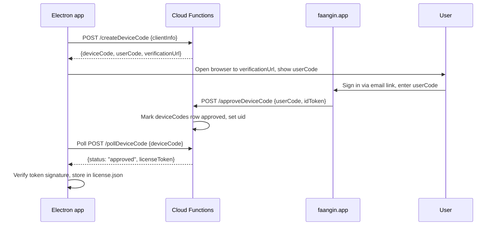

_Last updated: 2026-10-27_

# Billing Architecture

This document is the mental model the rest of the docs assume. It covers how the Electron app, Firebase Cloud Functions, Firestore, Stripe, and the (separate) Pro gateway fit together; what each side is allowed to know; and the shape of the license tokens that gate paid features.

## System diagram

```mermaid
flowchart LR
    subgraph Client["Faangin.app (Electron, macOS)"]
        UI[Overlay UI]
        LicStore[("Local license store\n~/Library/Application Support/\nFaangin/license.json")]
        PubKey[/"Baked-in last-known-good\nEd25519 public key"/]
    end

    subgraph Web["faangin.app (website)"]
        DC[Device-code sign-in page]
        Pricing[Pricing + Checkout entry]
    end

    subgraph GCP["Google Cloud / Firebase"]
        Fn[/"Cloud Functions v2\n(us-central1)"/]
        FS[("Firestore\nentitlements/\ndeviceCodes/\nstripeEvents/\nrevokedJtis/")]
        KMS[("Cloud KMS\nEd25519 signing key")]
        SM[("Secret Manager\nStripe keys, etc.")]
    end

    subgraph Stripe["Stripe"]
        Checkout[Checkout Session]
        Portal[Customer Portal]
        WH[Webhook events]
    end

    subgraph Gateway["Pro gateway (Cloud Run, separate repo)"]
        GW[gpt-transcribe proxy]
    end

    UI -->|1. request device code| Fn
    UI -->|2. open browser| DC
    DC -->|3. email-link sign-in| Fn
    DC -->|4. approve device code| Fn
    UI -->|5. poll /pollDeviceCode| Fn
    UI -->|6. receives signed license token| LicStore

    Pricing -->|/createCheckoutSession| Fn
    Fn -->|Checkout URL| Checkout
    Checkout --> WH
    Portal --> WH
    WH -->|signed events| Fn
    Fn <-->|read/write| FS
    Fn -->|sign token| KMS
    Fn -->|read secrets| SM

    UI -->|/mintGatewayToken\n(short-lived JWT)| Fn
    UI -->|audio stream + JWT| GW
    GW -->|verify JWT, meter usage| Fn
```

## Trust boundaries

The hard rule: **the server owns entitlements, the client owns UX.** The client never computes "is this user Pro"; it reads a signed license token and verifies the signature against a baked-in public key (with an online refresh path). The server never trusts anything the client sends about plan state.

What the **client** knows and does:

- The user's `uid` (after sign-in) and a locally generated `deviceId` (a UUID, persisted).
- The most recently issued license token: a JWS-like payload with `uid`, `plan`, `features`, `jti`, `nbf`, `exp`, `grace`, and `devices[]`.
- The baked-in Ed25519 public key (last-known-good) and a cached current public key fetched from `/public/license-key`.
- How to call `/createCheckoutSession`, `/pollDeviceCode`, `/refreshLicense`, `/mintGatewayToken`.
- No Stripe keys, no OpenAI keys for Pro (those live in the gateway), no Firebase admin credentials.

What the **server** (Cloud Functions) knows and does:

- Stripe secret key, webhook signing secret, Firebase Admin SDK, KMS signing key handle. All read from Secret Manager at function cold-start.
- Authoritative plan state in `entitlements/{uid}` — plan tier, Stripe customer + subscription IDs, device list, revocation list.
- Idempotent webhook handling via `stripeEvents/{eventId}`.
- The only path to a signed license token: `issueLicense` + `refreshLicense`. The client cannot forge or extend a token.

What **Stripe** sees:

- Customer email, country, payment method. Price IDs on each Checkout Session. Metadata tags carrying our `uid` so the webhook can look up the entitlement.
- Nothing about which Mac the user is on, which features they used, or their OpenAI key.

What the **Pro gateway** sees:

- Short-lived JWTs minted by `/mintGatewayToken` (described below). The gateway verifies them against the same KMS public key, meters usage, and reports deltas back to Cloud Functions.
- No Stripe webhook traffic; no direct Firestore writes to `entitlements/`.

## Data model

Four collections, all server-only in rules (`allow read, write: if false` at the Firestore layer; access is through Admin SDK inside Cloud Functions).

### `entitlements/{uid}`

The authoritative plan record for a user. One doc per Firebase Auth uid.

| Field | Type | Notes |
|---|---|---|
| `uid` | string | Firebase Auth uid; also the doc id |
| `email` | string | Last-known email from Auth |
| `plan` | `"free" \| "byok" \| "pro_monthly" \| "pro_yearly"` | Authoritative plan tier |
| `status` | `"active" \| "past_due" \| "canceled" \| "refunded" \| "chargeback"` | Mirrors Stripe subscription status plus terminal refund/chargeback |
| `stripeCustomerId` | string? | `cus_...` once a purchase is made |
| `stripeSubscriptionId` | string? | `sub_...` for Pro; null for BYOK |
| `periodEnd` | timestamp? | Current paid period end for Pro |
| `devices` | array<{deviceId, firstSeen, lastRefresh, label?}> | Device cap enforced here (3 for Pro, 3 for BYOK) |
| `activeJtis` | array<string> | JWT ids currently valid; revoke by moving to `revokedJtis` |
| `byokUnlock` | bool | True if BYOK ever purchased; survives Pro cancellation |
| `createdAt`, `updatedAt` | timestamp | |

### `deviceCodes/{deviceCode}`

Short-lived (10 min) rows used for the browser-approval sign-in flow.

| Field | Type | Notes |
|---|---|---|
| `deviceCode` | string | 32-char random id; doc id |
| `userCode` | string | 8-char human-typeable code (`XXXX-XXXX`) |
| `clientInfo` | map | `{app, os, deviceLabel}` for the approval screen |
| `uid` | string? | Set once a signed-in user approves |
| `status` | `"pending" \| "approved" \| "denied" \| "expired"` | |
| `expiresAt` | timestamp | TTL deletes it |

### `stripeEvents/{eventId}`

Idempotency ledger. The webhook writes `{eventId}` once per `evt_...` and refuses duplicates. Stored events: `checkout.session.completed`, `customer.subscription.updated`, `customer.subscription.deleted`, `charge.refunded`, `charge.dispute.created`, `invoice.payment_failed`, `invoice.payment_succeeded`. These are the full `HANDLED_STRIPE_EVENTS` set the sibling scaffold imports.

### `revokedJtis/{jti}`

A deny-list of JWT ids. Written when a device is removed, a subscription is canceled mid-period for cause (chargeback, refund), or the user signs out of all devices. Rows carry `uid`, `revokedAt`, `reason`.

## License token lifecycle

Tokens are compact Ed25519-signed JSON (JWS-shaped, `alg: "EdDSA"`). The server mints them; the client verifies them.

### Payload fields

| Field | Meaning |
|---|---|
| `uid` | Firebase Auth uid the token is bound to |
| `plan` | `byok` / `pro_monthly` / `pro_yearly` |
| `features` | Capability bitmap: `{fast: true, smart: true, transcribe: "gpt" \| "byok" \| false}` |
| `deviceId` | The specific device this token was issued to |
| `jti` | Random 128-bit id, unique per token |
| `iat` | Issued-at |
| `nbf` | Not-before (same as `iat`) |
| `exp` | Expiry — 30 days after `iat` |
| `grace` | Grace-until — 44 days after `iat` (14-day grace window) |

### Issue

A fresh token is issued when: a device completes device-code sign-in and the uid has an entitlement, OR a user purchases BYOK/Pro on an already-signed-in device. The function:

1. Checks `entitlements/{uid}.status` is one of `active`, `past_due`.
2. Checks `devices[]` has room (or the requesting `deviceId` is already present).
3. Mints a `jti`, pushes it to `activeJtis`.
4. Signs the payload with the KMS key.
5. Returns the compact token.

### Refresh

Clients call `/refreshLicense` with their current token (even if expired, up to `grace`). The function re-checks entitlement state and issues a new 30-day token with a new `jti`. The old `jti` moves from `activeJtis` to `revokedJtis` only if the new token's `features` differ (plan change) — otherwise it stays active to tolerate overlap during refresh.

### Grace

Between `exp` and `grace`, the client treats the token as valid but shows a "reconnect soon" nudge and attempts background refresh on every launch. After `grace`, features gate off; the user must sign in again.

### Revoke

Three paths revoke a `jti`:

- User removes a device from the Pro portal in-app → that device's `jti` moves to `revokedJtis`.
- Webhook fires `charge.refunded` or `charge.dispute.created` → **all** `jti`s for that uid are revoked and `status` is set accordingly.
- Admin tool (not in launch scope) can revoke individually.

The client learns about revocation on its next online check; offline, the token still verifies cryptographically. This is accepted risk (see [security.md](./security.md)).

## Device-code sign-in flow



Timeouts: device code expires in 10 min; the app polls every 3 s with jittered backoff on 429.

## Pro gateway integration (scoped out)

The gpt-transcribe gateway is a separate Cloud Run service with its own repo and its own setup doc. It is NOT deployed by this scaffold. The hand-off surface the scaffold MUST provide is:

- **Endpoint**: `POST /mintGatewayToken` on the main Cloud Functions deployment.
- **Auth**: caller presents a current license token.
- **Response**: a short-lived JWT (default 5 min, Ed25519-signed with the same KMS key) with claims `{uid, plan, nbf, exp, allowances: {transcribeSecondsRemaining, dayCapRemaining}}`.
- **Gateway behavior**: verifies the JWT; forwards audio to the OpenAI transcribe endpoint; reports consumed seconds back to a `/consumeAllowance` endpoint on Cloud Functions after each session.

What this scaffold does **not** build: the Cloud Run deployment, the OpenAI key custody there, the audio-streaming WebSocket contract, or the usage-ledger Firestore collection. Those live in the gateway's own repo.

## Threat model summary

- **Replay** — a stolen token could be used by an attacker. Mitigated by `jti` + `revokedJtis`, 30-day `exp`, device-bound `deviceId` field (the gateway and Fn cross-check this against `entitlements.devices[]`).
- **Offline bypass** — once a valid token is on disk, it works offline until `grace` passes. We accept this; it's the price of offline grace, which is a feature. The 30-day `exp` bounds the window.
- **Device-cap bypass** — rotating `deviceId` locally doesn't help: the server owns `devices[]` and rejects issuance when full. The user must explicitly remove a device from the portal.
- **Chargeback abuse** — a refunded user retains an offline token until `grace` passes. Mitigated by `charge.refunded` webhook revoking all `jti`s on next online check. Accepted that a user who refunds and immediately goes offline can get up to 44 days of use; we flag this in [security.md](./security.md) and consider it bounded.
- **Token theft** — exfiltrated license file lets an attacker use the plan. Device-bound JWT reduces blast radius (gateway refuses it from a different `deviceId`-labeled network context); user can revoke-all from the portal. Not perfect; acceptable for launch given the user population.

Full discussion in [security.md](./security.md).
