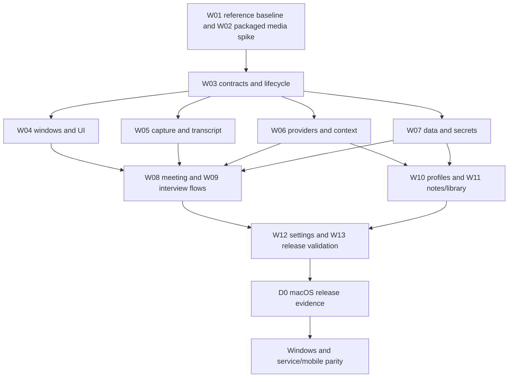

# Engineering team and delivery plan

Status: ready for implementation planning · October 11, 2026  
Authoritative scope: [PRD](../prd.md)  
Current deliverable: research and specification; no application implementation

## Team structure

The research team has completed three independent workstreams: public product evidence, Cue source analysis, and reliability/security. Their findings informed the PRD and were reviewed again for scope and technical consistency. The implementation team should use the ownership below. These are responsibilities, not fictitious named employees or credentials.

| Role | Owns | Accountable output | Reviewer |
| --- | --- | --- | --- |
| Technical lead / principal desktop architect | Shared contracts, platform support, dependency sequence | Integrated working application and architecture decisions | Reliability + component owners |
| Product / interaction engineer | Native reference baseline, flows, UI states, parity ledger | Overlay, dashboard, library, settings, keyboard/accessibility evidence | Desktop platform |
| Desktop / media engineer | Windows, permissions, screen/audio, shortcuts, OS lifecycle | Packaged capture adapter and capability matrix | Reliability/security |
| Inference / context engineer | Provider/speech adapters, context compilation, output contracts | Cancellable streaming, grounded responses, quality benchmark | Product + reliability |
| Data / security engineer | Credentials, imports, durable sessions, search, deletion | Crash-safe repository and narrow trust boundaries | Platform + reliability |
| Reliability / release engineer | Fixture harness, fault injection, packaging, metrics | Reproducible release evidence and unresolved-risk register | Technical lead |

With a small project team, one contributor may own several roles. Each release-critical change still receives review from someone outside its primary implementation. During parallel implementation, use disjoint module ownership and integrate through versioned contracts. Component availability is insufficient; the technical lead owns the end-to-end demo.

## Handoff package

Review in order: [report](../project-report.md), [product evidence](../research/product-parity.md), [Cue source audit](../research/cue-audit.md), [reliability audit](../research/reliability-audit.md), [PRD](../prd.md), [architecture](architecture.md), and [validation](validation-plan.md).

Each owner receives the same requirements and evidence limitations. Add an issue for each work package below with its mapped requirement IDs, acceptance tests, dependency list, and concrete output. Do not invent dates or mark an unimplemented package complete. Repository commits describe actual changes, and test reports include actual commands and environments.

## The comprehensive first implementation milestone

D0 is one integrated macOS delivery covering the whole primary product loop. It includes capture, streaming assistance, coding practice, profiles/prompts, notes/library, settings, privacy, recovery, diagnostics, and packaging. It is broader than a UI prototype or a single-provider chat demo.

The work packages can be built in parallel after the contracts and platform spike settle. They are not independent releases. The first release is complete only when the packaged fresh-install workflow passes. The platform gate cannot be skipped to accelerate the apparent feature count.

## Work packages

| Package | Owner | Requirements | Depends on | Reviewable result / exit condition |
| --- | --- | --- | --- | --- |
| W01 Reference and certification baseline | Product + release | F03/F05/F18/F42, all V items | Authorized app access for native claims | Version/plan/OS observation scripts, state screenshots, actual keymap, finite support/provider/language matrix; unresolved access gaps remain labeled |
| W02 Packaged macOS capture spike | Desktop/media | F01/F05/F06/F08/F37/F40 | Supported Electron selection, physical machine | Installable test artifact captures known screen/mic/system sources, detects dead streams and denial, disposes late acquisitions; minimum OS decision and helper decision recorded |
| W03 Typed contracts and state machines | Lead + reliability | F09/F10/F19/F31/F35 | W02 findings | Validated preload boundaries, capture-generation/transcript-epoch semantics, request IDs, error taxonomy, deterministic clock/transport fixtures |
| W04 Desktop shell and interaction | Product/desktop | F02/F03/F04/F34/F42 | W03 | Overlay/dashboard, keyboard/preset controls, click-through recovery, monitor-safe placement, accessible named states; proposed visuals distinguished from reference measurements |
| W05 Audio/screen/transcript foundation | Media/inference | F06–F12/F40 | W02/W03 | Selected capture sources, image tray, independent channels/meters, partial/final revisions, reconnect/backoff, bounded queues, Stop/drain behavior |
| W06 Providers, requests, and context | Inference | F13–F19/F25/F32/F35/F41 | W03, provider decision and credentials | One certified chat/vision provider and one streaming speech path, custom compatible chat interface, capability validation, real abort, usage, prior-answer context, no startup dispatch |
| W07 Data, imports, and credentials | Data/security | F24/F30/F31/F33/F36 | W03 | OS-protected secrets, SQLite transactions/migrations, private data paths, bounded inert parsers, retention/trash/export, redacted diagnostics; packaged database-binding compatibility |
| W08 Meeting workspace | Product/inference | F13–F17/F28/F41 | W04/W05/W06/W07 | Start → transcript → Assist/reply/follow-up/recap → Stop → saved session → notes/draft; Ambient Chat and idle ending; all missing-source states |
| W09 Interview workspace | Product/inference | F07/F20–F22 | W04/W05/W06/W07 | Screenshot import/capture/tray → problem → language/preset → structured solution → debug/follow-up → reset; executable correctness fixtures |
| W10 Profiles, modes, and languages | Product/data | F12/F18/F23/F24/F34 | W06/W07 | Visible background/document/story flows, extraction preview/removal, editable response and note templates, factual grounding, independently selected input/output languages |
| W11 Notes and session library | Data/product | F28–F32 | W07/W08/W10 | Search/open/edit/resume/export/delete/trash/restore, transcript references, opt-in memory; notes failure never loses recorded session |
| W12 Settings, diagnostics, and recovery | Product/reliability | F01/F03/F25/F33–F36/F40/F41 | Integrated W04–W11 | All preferences persist truthfully; credentials masked; device/permission/provider/disk recovery paths; no sensitive logs; accessibility pass |
| W13 macOS release and benchmark | Release + all owners | All D0 requirements | W01–W12 | Locked build, package/signing evidence, fresh profile install, 60-minute sessions, failure tests, measured SLOs, requirement evidence index, short reproducible demo |

W01 native commercial observations may remain blocked by access. W02–W13 can still establish Faangin's own documented capability baseline after implementation authorization, but the result cannot be labeled exact commercial parity.

## Integration rules

1. Freeze contract v1 after W02; change it through a small reviewed design note. Each event identifies session, generation/epoch, request, and relevant sequence bounds.
2. Each component supplies its real implementation plus deterministic fixtures. Fixtures are used for development/testing and are labeled; they never masquerade as live inference in a release demo.
3. Merge reachable workflows with their failure states. A profile import handler without UI, or notes storage without a library, does not close its work package.
4. Run relevant targeted checks after each change; run the integrated suite/package smoke once for the combined milestone and again only after relevant changes or failures.
5. Keep reference material outside the application tree. Preserve notices for actual upstream dependencies. Document behavioral inspiration without copying GPL or commercial assets into an MIT implementation.
6. Complete the architecture/capture review before broad UI/inference parallelism. During parallel work, avoid shared-file editing and assign one integration owner to cross-module changes.

## Full parity expansion work

| Workstream | Requirements | Dependency and acceptance |
| --- | --- | --- |
| Windows desktop | F38, Windows-specific F01–F41 | Shared domain contracts; real Windows 11 x64 device, WASAPI/Chromium loopback and display-affinity matrix; its own signed installer gate |
| Local speech | F26 | Verified upstream runtime/model rights and immutable downloads; real arm64/x64 packaging/inference, bounded queue, offline/no-fallback evidence |
| Additional Cue capabilities | F43–F46 | Selected-display slide tracking, scoped local tooling, current verified provider adapters, and independently designed managed gateway; no borrowed identity/tokens/contracts |
| Smart research | F27 | Provider/tool decision, explicit data destination, source quality/citation evaluation and cancellation |
| Calendar preparation | A01 | OAuth integration, scoped calendar access, timezone/DST handling, briefs, disconnect and revoked-token tests |
| Hosted identity/data/sharing | A02–A04/A09 | Service architecture review; authenticated accounts, permission model, sync conflicts/deletes, revocable sharing; no production deployment implied |
| Entitlements/billing/referrals | A05/A11 | Server-authoritative idempotent usage ledger, test-mode payment/referral states, plan matrix; production secrets/transactions require separate authorization |
| Mobile | A06 | Native iOS capture/session UX and cross-device store contract; documented mobile-specific limitations and independently tested supported devices |
| Prep/web utilities | A07/A08 | Original/licensed dataset, company/topic/difficulty/newest filters, pagination/detail, offer-data source/freshness; original public website |
| Updates/version/analytics | F39/A12 | Signed artifacts, idle update/migration rollback, release catalog, opt-in event-field contract; no content collection by default |
| Unverified commercial behaviors | All V items, A10 | Authorized versioned native observations; preserve unknowns and avoid unsupported universal guarantees |

## Review and release gate

Principal review asks whether the architecture can fail safely, whether feature status reflects reachable operation, and whether measurements support the release claims. Review findings must be resolved or recorded with an explicit effect on support scope. A passing mock suite cannot waive a failed native test.

The D0 demonstration starts with a fresh installation, grants permissions, configures a certified provider, captures a scripted meeting, requests assistance, stops, generates notes, searches/edits/exports/resumes the session, then solves and follows up on a coding fixture. Show a failure and its recovery. Include OS/package/provider versions and clearly distinguish any synthetic fixture inputs.

The public README gains installation instructions and demo media only when those artifacts exist. Use actual benchmark results, an accurate feature checklist, a coherent commit history, and original branding. The next implementation pass begins with W02 and W03, followed by parallel component work and an integrated D0 artifact.
