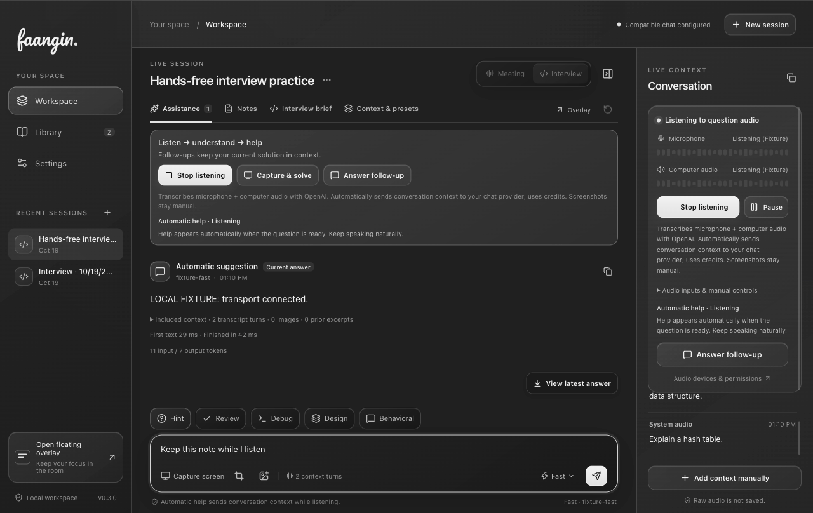

# Hands-free interview candidate 0.3.0

October 19, 2026. The interview now has one deliberate **Start hands-free** action. It enables microphone and computer audio, selects computer audio as the question source, and enables automatic help. Recording never starts on launch. Transcription uses the saved OpenAI connection; generated help uses the saved chat provider. The action explains both sources, automatic context transmission and provider credits before starting.

After starting, spoken questions and follow-ups can produce assistance without another click. Capture a problem once or supply an interview brief when the problem is visual; subsequent answers retain the bounded working solution, code/design and revisions. Screenshots remain explicitly selected and sent. Manual source selection, Listen only, Capture & solve, and Answer follow-up remain available under the audio controls or interview rail.

## Conversation decisions and interruption

An automatic interview request makes one model call that first decides whether useful help is needed. Its private framing is `ASSIST` followed by the answer or `WAIT` without an answer. The streaming decoder strips the framing before display. WAIT creates no answer card, saved answer or false working solution. Malformed framing pauses automatic help with an explicit recovery action; it is not displayed as assistance.

The model receives the exact trigger, bounded neighboring speech from both channels, recorded prior question targets, the working solution and scenario evidence. It is instructed to distinguish a request, challenge or changed constraint from candidate thinking, quoted questions, acknowledgments, adequately answered questions and incomplete utterances. It can answer an instruction without a question mark. Conditional scenarios stay conditional. Algorithm comparisons must account consistently for visited, parent/distance, stack and frontier state; BFS and DFS do not acquire different general-graph worst-case space bounds merely because one uses a queue.

The selected question source owns automatic triggers. The other source contributes context rather than creating competing replies. If other-source speech finalizes after dispatch but before any assistance appears, the coordinator cancels the unpublished request and reassesses the same target using the fresh conversation. This uses the same spacing and cost limits. Once useful text is visible, candidate speech does not automatically replace that answer. A new selected-source question or its continuing provisional speech can interrupt obsolete output; interrupted drafts retain provenance and do not become completed evidence. Intent is assessed from available finalized observations, not perfect continuous speaker recognition.

Channels identify capture sources. Separate remote audio and microphone provide useful role hints, but neither identifies a verified speaker. In-person capture can contain both people on one microphone and remains ambiguous. A generated suggestion does not prove that the candidate spoke or adopted it.

## Capture and timing

Microphone and computer audio retain separate processing, VAD, buffers, transports and failures. Microphone requests native echo cancellation and noise suppression. Those constraints are best effort. Stereo downmix preserves one-sided speech and avoids opposite-polarity cancellation; the resampler maintains frame cadence across common and high input sample rates. Mute/unmute can recover in place; processor failure is reported immediately.

| Local behavior | Previous | 0.3.0 |
| --- | --- | --- |
| System-audio silence endpoint | 600 ms | 320 ms |
| Microphone silence endpoint | 600 ms | 400 ms |
| Continuous-speech transport chunk | 15 seconds | 6 seconds, without restarting speech admission or replaying samples |
| Final-turn coalescing | 350 ms | 120 ms |
| Minimum automatic request spacing | 3 seconds | 800 ms |
| Rolling request limit | 6/minute | 20/minute |

These are application timing settings, not end-to-end latency promises. Only one automatic request runs at a time and only the latest pending target is retained. Limits survive cancellation/reset so repeatedly interrupting cannot bypass them. Failure pauses instead of repeatedly spending credits; **Resume automatic help** explicitly resumes while healthy capture continues.

Automatic help shows Ready, Listening, Understanding, Answering, Waiting or Paused. Enabled-but-idle is Ready rather than Off. A muted or failed secondary input stays visible. Start is protected against duplicate clicks, session/context changes and conflicting capture. Stop invalidates setup even while settings are saving, preventing an unexpected restart. Automatic answers preserve the typed draft and keyboard focus.

Technical transcription context includes bounded problem/constraints and programming vocabulary, not profile, notes or named-speaker assertions. Current OpenAI guidance requires client commits for `gpt-live-transcribe`; it does not support server/semantic VAD or speaker labels. See the [official transcription guide](https://developers.openai.com/api/docs/guides/realtime-transcription).

GPT-6 Luna and GPT-6.1 Sol are offered in Settings, with documented image support and explicit `none`/`low` reasoning respectively. Saved model IDs are not migrated by source defaults. The primary workspace was deliberately configured through the app to use Luna for Fast, Sol for Smart, and Fast by default after access verification. See [GPT-6 Luna](https://developers.openai.com/api/docs/models/gpt-6-luna) and [GPT-6.1 Sol](https://developers.openai.com/api/docs/models/gpt-6.1-sol). Access, cost and latency depend on the provider/project.

## Verification

- **533 tests passed**, no failures or skips, plus TypeScript and production build.
- Source and packaged desktop checks each passed **21 localhost fixture requests**, including screenshot and audio follow-up continuity, interruption, late candidate-context reconsideration, hidden WAIT, malformed framing, safe quota pause, cancellation, restart and stored provenance.
- Focused desktop QA verified both-channel fixture context, no protocol leak, Stop → Ready/audio off, preserved draft/focus, usable 1280/1000/900px workspaces and a 480px overlay. Its one mock request used no credentials or native stream. [QA report](../assets/hands-free-qa-v030.json), [light view](../assets/hands-free-interview-light-v030.png), [overlay](../assets/hands-free-overlay-v030.png).
- The actual updated app also completed the two tiny **Test chat generation** probes using the saved Fast/Luna and Smart/Sol models. The workspace reopened as 0.3.0 with all 15 saved sessions listed, Fast selected, Start hands-free visible and audio off.
- With user approval, a separate disposable Electron profile read the existing encrypted OpenAI key in memory and sent only synthetic public speech and interview text. No actual sessions, screenshots or microphone audio were sent. GPT Live Transcribe reproduced the BFS/DFS shortest-path question. Final transcript arrived **667 ms after commit** for the 5.78-second sample.
- Five live Luna trials made the expected ASSIST/WAIT decisions: new BFS question, adequately answered question, acknowledgment, nonnegative-weight scenario change, and candidate thinking. Manual review of the final visible answers confirmed the BFS shortest-path invariant, consistent O(V) general-graph auxiliary space, and Dijkstra/min-priority queue for nonnegative weights. First useful assistance appeared **1,022–1,573 ms after generation dispatch**; WAIT decisions completed in 912–1,698 ms. These are a small synthetic sample, not a representative distribution or hardware test.
- One intermediate live evaluation ended with `malformed_response`; a subsequent bounded rerun completed. There is no claim of perfect provider availability or semantic accuracy. The app pauses automatic help on provider failure and retains useful received output.

The normal launch bundle is updated separately from the preserved 0.2.10 bundle. Artifacts, logs, model-access results, synthetic live results, checksums and source/package provenance are in ignored `dist/handsfree-candidate`. The build is local and unsigned. Physical microphone/computer-audio routing, conferencing/headset combinations, accents/noise, long-session behavior and broad answer-quality evaluation still require representative live-call acceptance. No fixture or synthetic trial certifies those conditions.
