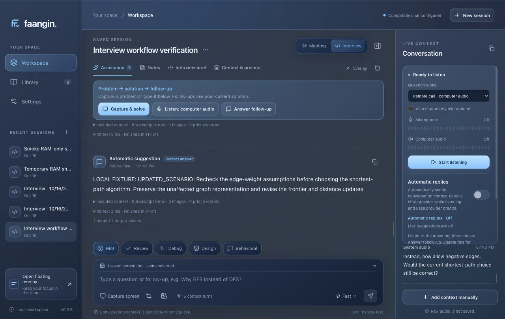

# Interview context · 0.2.5

This candidate keeps the current question, proposed solution and later scenario changes together. See the [candidate build status](build-status.md#interview-context-candidate-025) for the final source, package and artifact checkpoint.

## Using the interview workflow

1. Capture & solve a problem, send a selected screenshot, or start with a spoken question. Save the problem, constraints and your own attempt in the interview brief when useful.
2. Choose **Question audio**: computer audio for a remote call or microphone for an in-person question. Stop listening before changing inputs. The selected input identifies an audio source, not an interviewer or candidate.
3. Listen to follow-ups and choose **Answer follow-up**. If a question changes while an answer is streaming, choose **Answer latest** to replace the response using the latest finalized question. Listening continues. If the previous transport cannot stop within its deadline, the app reports that state instead of overlapping the replacement.
4. Enable **Automatic replies** only when automatic provider requests are wanted. Continuing selected-source speech interrupts an automatic response; a distinct newer finalized turn from that source also interrupts an active manual interview response. Interruption preserves received text as an unfinished draft. It does not by itself authorize a new manual request, and ordinary duplicate text does not repeatedly take over.

An unweighted graph can become a weighted-graph discussion, a design can gain new consistency requirements, or a behavioral question can introduce a hypothetical variation. The next answer receives the actual quoted change together with the relevant earlier work. Review the result, especially when the new requirement is ambiguous.

## Causes and changes

Previously, general history was off by default, so spoken follow-ups could lose the screenshot solution or the first audio answer. Solve and Design also excluded earlier working answers, and a combined problem/constraint hash discarded the baseline after a constraint edit. Recent-only transcript clipping could remove an early revision or the important ending of a long question. A response could therefore continue using obsolete assumptions or restart without its earlier implementation.

Interview requests now assemble bounded same-session context: the question focus and neighboring segments, chronological exchanges, saved constraints before and after revision, evidence since the complete baseline, and references to the working implementation or design. The same continuity supports screenshot Send/Assist, audio-only starts, Solve, Design and behavioral practice. This current interview context is available independently of the general history toggle.

Source assembly does not classify changes using English keyword rules. It quotes source passages with turn IDs, timestamps and exact excerpt offsets. Response instructions ask the model to distinguish adopted requirements, hypothetical variations, clarifications, corrections and different problems. A proposed alternative or a “what if” is not automatically an accepted requirement. Conflicting evidence calls for a focused clarification or conditional answer.

Coding guidance rechecks invariants, weighted-graph assumptions, cycles, complexity and memory feasibility. Design guidance rechecks scale, units, read/write balance, consistency and affected components. Behavioral guidance separates hypothetical responses from supported past experience and prohibits invented personal achievements.

## Working answers, drafts and boundaries

A complete baseline remains available when a stream is interrupted. Its partial replacement appears only as an explicitly interrupted, untrusted draft in reference data; it never becomes a completed assistant exchange or proof that code was implemented or run. Intentional cancellation without interruption metadata is excluded. A newer complete same-problem answer retires a draft it explicitly consumed, while a later interrupted draft can still be included.

Session/context reset, a replaced problem statement or round, and a newly selected problem screenshot prevent unrelated prior work from becoming the baseline. Constraint edits retain modern saved baselines so the answer can explain what must change. Older answers without a saved brief snapshot use conservative matching. These checks also constrain opted-in interview history. Meetings and finalized Notes, Recap and follow-up drafts do not acquire this interview situation context.

## Bounds

| Context | Limit |
| --- | --- |
| Complete prior exchanges | Six, within 12,000 text characters; reserve space for the baseline and relevant implementation detail |
| Main transcript | Fast: 60 turns / 8,000 characters; Smart: 200 turns / 24,000 characters |
| Additional revision evidence | Twelve quoted turns / 6,000 characters; retain the first two post-baseline turns and recent discussion when trimmed |
| Question focus | 2,000 characters for the latest finalized utterance, plus two preceding excerpts of up to 600 characters each |
| Interrupted output | One eligible draft, up to 2,400 text characters plus a bounded request excerpt |

Long excerpts preserve their beginning and ending. Omitted evidence and clipping are marked. This is bounded evidence for reasoning, not a complete or automatically accepted requirement ledger. Automatic replies remain image-free; selected screenshots are sent with explicit manual assistance.

## Verification and remaining acceptance

The current full source regression checkpoint passed **473 tests, zero failures**. The final **0.2.5 source build** also passed a **17-request localhost desktop fixture**, including selected-source interruption of manual and automatic streams, explicit takeover, revised scenario evidence, and durable interrupted-draft provenance. The finished 0.2.5 app passed the same 17-request workflow, responsive/overlay checks and restart provenance checks. See the [build-status entry](build-status.md#interview-context-candidate-025) for artifacts and checksums.

Fixtures verify context contents, boundaries, interruption and transport behavior. They do not guarantee semantic correctness, interview-answer quality, transcription accuracy or perfect handling of every scenario. Real provider latency and quality evaluation, physical microphone/computer-audio routing and representative end-to-end interview trials remain outstanding. Approval to use the saved key for those live checks remains pending; these checks made no live provider calls or physical audio recordings.
