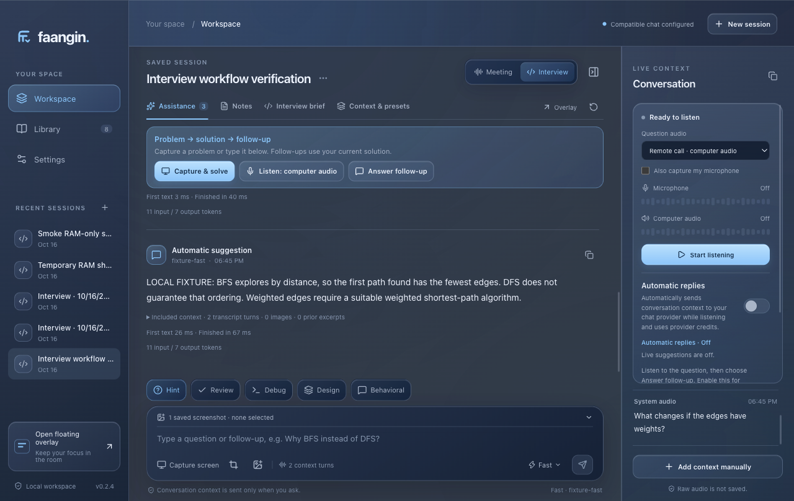

# Interview reliability candidate 0.2.4

October 16, 2026. This update focuses on the desktop interview workflow.

## Use the interview flow

1. Open an Interview session and choose **Capture & solve**. It captures the selected display/window and submits that exact new image. **Solve selected** also works for imported or already captured images. A compatible chat provider must support images to solve a screenshot.
2. Under **Question audio**, choose **Remote call · computer audio** for a voice coming through the computer, or **In person · microphone** for speech in the room. Start **Listen**. The selected preset enables that source; the second source is optional. Audio needs the separately saved OpenAI connection, even when chat uses a compatible service.
3. Verify the words in **Conversation**, then choose **Answer follow-up**. You can also type a follow-up without transcribing it. Enable **Automatic replies** to respond after finalized selected-source speech; this sends context automatically and uses provider credits.

Audio-only interviews keep up to six recent completed exchanges and their questions. The current generated solution and bounded related replies remain available to interview follow-up actions even when **Include additional prior answers** is off. New problem screenshots, a changed problem/constraints/round, a newer unfinished solution, and Reset prevent stale solution reuse. Original Capture screen → Send/Assist also retains a screenshot-backed answer. Automatic replies send text from the solution, not raw screenshots. They react to finalized utterances, not a semantic question classifier. A microphone can capture multiple people, including the candidate.

If capture or a provider request fails, the UI keeps the question draft and captured image for a deliberate retry. Source status distinguishes connecting, real PCM readiness, quiet/silent input, permission denial, missing devices, and disconnection. Stop listening before changing sources. The expanded overlay exposes the same primary interview controls.

## Causes repaired

| Failure | Repair |
| --- | --- |
| General history is off by default, so a BFS/DFS follow-up lost the actual proposed solution | Bounded working-solution context independent of additional-history opt-in; anchored to the current problem and selected-image provenance |
| Trimming answers to the last 12 dropped the solution in longer interviews | Compiler selects the anchor before applying request context limits |
| Prior spoken answers had an empty user prompt | Recover their question from the recorded transcript source IDs and retain question/answer pairs |
| Reply before the silence tail used an older question | Commit already accepted audio, await its final transcript with a 2.5-second bound, then compile; duplicate preparation is rejected |
| Stop discarded accepted unfinished speech | Finalize already accepted audible PCM within the existing five-second drain; admit no new frames after Stop |
| Listening appeared before an audio frame arrived | Require valid 20 ms PCM frames for readiness; clean up nodes/tracks/timers on startup failure and detect missing frames |
| Quiet speech was rejected at .015 RMS | Three-frame .006 onset and .004 release hysteresis, with matching health/unfinished-speech diagnostics |
| A removed saved microphone stranded listening | Fall back once to the default input and show the change |
| Unrelated hardware changes restarted both transcription channels | Reconnect only for a missing selected input or ended source; resume suspended AudioContexts before teardown |
| Screenshot capture, source selection and replies lived in separate controls | Persistent Capture & solve → Listen → Answer follow-up controls, inline audio presets, optional automatic replies and recovery guidance |
| Typed follow-ups incorrectly required transcript text; concurrent operations could clear pending state | Typed follow-ups use Ask with no image resend; pending operations and draft restoration retain session/epoch ownership |

## Reference review

Interview Coder's [public help](https://www.interviewcoder.co/help) emphasizes onboarding/basic checks, while its [changelog](https://www.interviewcoder.co/dashboard/changelog) documents partial transcripts, response support for screenshots, upload on recording stop and clickable audio errors. Its [home page](https://www.interviewcoder.co/) advertises audio guidance across interview types. These pages do not establish its private prompts, live model quality, or capture reliability.

The earlier [versioned static client investigation](../research/rea-live-suggestions.md) traced separate microphone/system channels, transcript-driven insights, and committing pending transcriptions before a manual response in the inspected InterviewCoder 3.0.1 client. This update applies the useful interaction principles with original implementation. It does not invoke that product's backend or claim complete parity. OpenAI's [official realtime transcription guide](https://developers.openai.com/api/docs/guides/realtime-transcription) supports explicit client-side commits, incremental/final events and matching unordered final events by item ID.

## Verification

The final build passed 427 tests, production compilation and both source/packaged 13-request desktop fixtures, including three viewport sizes and expanded-overlay controls.

See the [0.2.4 build record](build-status.md#interview-reliability-candidate-024) for final checks, artifacts and checksums. Unit/transport tests exercise PCM readiness, quiet speech, failure cleanup, fallback inputs, commit/flush/stop timing, cancellation, context budgets and stale problem boundaries. The desktop smoke uses disposable storage, a synthetic image, public text proxies and a localhost fake provider. It clicks actual Solve selected and Answer follow-up controls, checks the admitted screenshot, checks audio-only conversational continuity, then checks manual BFS/DFS and automatic weighted-edge follow-up continuity with general history off and no automatic image resend. Existing source/partial/duplicate/disable/stop/failure controls and persistence run in that same smoke.

These tests establish application behavior under controlled inputs. Real microphone/system-audio quality, the saved provider's access/quota, model answer quality, representative latency and conferencing-device compatibility need a live check. No primary app preferences, credentials or transcripts are changed by the isolated checks. The candidate is a local unsigned development build; Developer ID signing/notarization and Windows validation remain separate release work.
